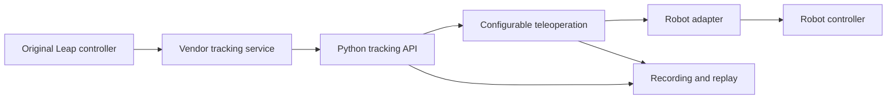

**Product design for `source-robotics-leap-motion` - revised 5 November 2026**

The deployment preference is now a minimal runtime managed by this package, so users do not separately install the vendor GUI suite. The project owner has confirmed redistribution permission. Runtime delivery, the supported minimum Windows components, and any unavoidable USB-driver setup still need to be completed and tested before making that installation promise. See [minimal runtime investigation](docs/MINIMAL_RUNTIME.md). Alpha 0.1.0a3 adds local bundle preparation and a managed launcher. The private engine has delivered real hand skeletons as an ordinary user with the installed service stopped: 1,047 frames over ten seconds, including 50 full hand samples. Clean-PC installation and robust repeated camera handoff remain separate checks.

Build a reusable Python library and a small companion command line tool. Users should install it with `pip install source-robotics-leap-motion`, obtain hand data with a short Python example, and connect different robot arms through configuration and small adapters. The user has confirmed the exact device as **Original Leap Motion Controller**; this is the first hardware target. The current Windows machine is the initial integration platform. PAROL6 and CM6 remain optional examples; their kinematics, home positions, protocols, and motor libraries must not determine the core API.

This design supersedes the robot-specific implementation priorities in [the earlier assessment](MODERNIZATION_PLAN.md). Implementation has started as local alpha `0.1.0a3`; see [README.md](README.md) for the implemented API and commands. Python 3.10 through 3.15 have now been verified in separate venvs; see [compatibility and performance](docs/COMPATIBILITY_PERFORMANCE.md). The complete teleoperation design below remains a roadmap, and the package has not been published.

The first implementation also includes a pure-Python protocol-v6 WebSocket backend for existing legacy services. It was verified with this PC's service `3.2.1+45911`, Python 3.15.2, and the actual Original Leap Motion Controller: 3,399 live frames captured over 30 seconds, including 53 left-hand frames with a complete finger skeleton. Recording and replay passed. No runtime upgrade was required. Auto mode tries installed LeapC first and then the loopback legacy endpoint. This extends the installation options below: an existing working legacy tracking service can be reused without `LeapPython.pyd` or Python 3.8. The only Python runtime dependency is the automatically installed `websocket-client` package. See [hardware validation](docs/HARDWARE_VALIDATION.md) for the evidence and remaining checks.

**The installation promise needs two clear parts.** One pip command can install our Python library, CLI, and permitted native client components without a compiler, manual DLL copying, environment-variable setup, or a Python 3.8 helper process. Live tracking also needs the vendor's tracking engine and device support. LeapC is a client of a separate hand-tracking service; it does not itself run the hand-tracking engine. [Vendor LeapC architecture](https://docs.ultraleap.com/api-reference/tracking-api/leapc-guide.html)

| Computer state | Intended first-use experience |
| --- | --- |
| Compatible vendor runtime already installed and working | `pip install`, then use the API or CLI. Detect the runtime and camera automatically. |
| Vendor runtime missing | The first explicit CLI launch detects what is missing and offers the vendor-supported setup flow, subject to the selected runtime's distribution and automation terms. There may be a license screen and an operating-system approval prompt. |
| Existing incompatible runtime, including the current 3.2.1 service | Explain the incompatibility and offer an intentional migration path. Preserve existing installation details and do not replace system tracking software merely on import. |
| No connected camera or unsupported platform | Import, replay, configuration, and non-hardware operations still work. Opening live tracking provides a precise diagnostic. |

A normal wheel installation copies package files and creates entry points; it is not a portable system-driver installation mechanism. Put prerequisite handling in explicit first use, not a build hook. On Windows, creating a service requires administrator privileges. Therefore, zero prompts on an untouched PC is not currently a promise we can make. Minimize manual work and report the tested experience accurately. [Wheel installation specification](https://packaging.python.org/en/latest/specifications/binary-distribution-format/), [Windows service access rights](https://learn.microsoft.com/en-us/windows/win32/services/service-security-and-access-rights)

Ultraleap currently lists Hyperion 6.2.0 for the original controller on Windows. Treat this as the first runtime candidate to test with the actual device. The existing project and service use 3.2.1; replacing that runtime is an integration change to verify separately from packaging. [Original controller downloads](https://www.ultraleap.com/downloads/leap-controller/)

The project owner confirmed redistribution permission on 5 November 2026. Use that confirmation as the project's permission basis for runtime packaging; do not keep treating permission as an unanswered request. Runtime delivery, platform selection, accompanying notices, and clean-machine checks remain implementation work. The existing wheel still excludes vendor assets. See [installation and platforms](docs/INSTALLATION_PLATFORMS.md).

If a supported userspace deployment of the tracking engine exists for the chosen runtime, investigate it as a way to reduce setup. Do not assume such a deployment works, bypass its license, or budget for replacing the proprietary tracking engine. Until tested, the supported service installation is the baseline.

**Separate hand tracking from robot operation.** The library should provide three independently useful layers:

| Layer | Responsibility | Customization |
| --- | --- | --- |
| Tracking | Connect, discover devices, poll events, copy owned frames, handle timestamps and reconnects. Expose palm, wrist, fingers/bones, handedness, IDs, orientation, pinch and grab data supported by the runtime. | Device selection, tracking mode, hand selection, event or iterator access. |
| Teleoperation | Map a selected hand into a Cartesian target, delta, or velocity intent. Apply calibration, coordinate transforms, gains, filtering, clutch/activation, workspace and motion limits. | Translation/orientation modes, axis mapping, reference frames, per-axis gains, filter settings, gesture/gripper mapping, output rate. |
| Robot adapters | Translate validated intent to a controller's documented interface and expose capabilities/status. | User callback, generic pose transport, or an optional controller-specific adapter. |



Supporting different arms means a stable extension point, documented coordinate conventions, and adapters. It cannot mean an unknown controller will move correctly without its endpoint, command interface, frame alignment, and limits. A robot that accepts Cartesian targets can use a small adapter. A joint-only controller needs robot-specific kinematics supplied by that adapter or a separate robotics stack. Keep inverse kinematics and hardware motor drivers out of the base dependency set.

Expose robot-independent data in explicit units: positions in metres, time units in named fields, velocities in metres per second and radians per second, and rotations through a documented quaternion type with named `x`, `y`, `z`, `w` components. Device timestamps retain their clock domain. Convert vendor coordinates once at the boundary; allow the teleoperation frame transform to be configured independently.

Raw frames must remain available so users can implement unusual mappings. Keep frame data independent of the vendor's native pointers. A frame containing no hands is a valid frame, not necessarily a disconnect. Retain handedness and tracked identity; acquiring a different hand or recovering from a long gap resets relevant calibration and filter state according to an explicit policy.

**A short API should be the primary interface.** This is the proposed shape, not runnable code in the current folder:

```python
from source_robotics_leap_motion import Tracker

with Tracker() as tracker:
    for frame in tracker:
        hand = frame.right_hand
        if hand is not None:
            print(hand.palm.position)
```

For a custom arm, supply a callback or implement a small adapter. The teleoperation API can resemble this:

```python
from source_robotics_leap_motion import Mapping, Teleoperator, Tracker

# my_robot implements the adapter contract for the user's controller.
mapping = Mapping.from_toml("my_arm.toml")

with Tracker() as tracker:
    with Teleoperator(tracker, robot=my_robot, mapping=mapping) as teleop:
        teleop.run()
```

The adapter contract should describe capabilities, connection lifecycle, target submission, feedback when available, and hold/stop behavior. Distinguish pose, delta, velocity, orientation, and gripper support so the core rejects unsupported combinations. A callback adapter provides the lowest-effort integration path; a managed adapter adds feedback and lifecycle handling.

A teleoperator starts disarmed. Calibration obtains the robot reference pose from feedback or an explicitly supplied starting pose. The core must not invent a home pose or apply one arm's workspace bounds to another. Activation, clutching, tracking loss, and rearming have documented transitions. Filtering and timing have deterministic reset rules. Controller-side enforcement remains necessary when the Python process or network disappears; an output callback alone cannot provide a receiver watchdog.

**Use LeapC without an extension tied to a Python minor version.** Evaluate a minimal `ctypes` binding first. Keep the declarations in one internal backend, generated or checked against the exact SDK headers. Verify native structure sizes, alignment, offsets, calling convention, function signatures, and pointer lifetimes. Test with actual hand frames and device/status events before claiming current-Python compatibility. The higher-level public API should not expose `ctypes` types. [Python ctypes documentation](https://docs.python.org/3/library/ctypes.html)

The core wheel can remain Python-only if it discovers a separately installed native client. If permitted native clients are bundled, distribute correctly tagged platform wheels; a Windows DLL does not belong in a supposedly platform-independent payload. Using `ctypes` removes the project's own compiled Python extension but does not remove operating-system, architecture, native runtime, or SDK compatibility requirements. [Python package formats](https://packaging.python.org/en/latest/discussions/package-formats/)

Resolve native libraries from explicit configuration, supported installation locations, or packaged resources. Report the chosen library and version. Do not ask users to copy DLLs, modify PATH, or compile bindings. An explicit override is useful for developers; the default path should need none.

Keep runtime discovery read-only. `import source_robotics_leap_motion` must not open USB devices, start threads, install software, elevate privileges, or contact robot endpoints. Opening `Tracker()` owns the hardware connection lifecycle. Only an explicit setup action may offer system changes; the CLI can offer that action when live tracking prerequisites are missing.

**Pip is the user-facing installation path.** Development may use a lockfile and an environment manager, but users should not need that tooling. Use the requested distribution name and the import name `source_robotics_leap_motion`. Package-name availability and publication credentials must be checked before release; a search result is not a reservation.

Aim for a dependency-light base install: tracking, typed data, essential transforms/filtering, configuration, and a basic CLI. Keep plotting, robot SDKs, ROS integration, and scientific toolboxes optional. Choose the minimum Python version from actual support needs while testing the latest stable Python; do not pin all users to an old minor version to satisfy a binary binding. Initially target and verify standard CPython 3.15 x64 on Windows; expand the declared support matrix only after installation and hardware checks.

The companion CLI should provide direct usefulness immediately after installation. These commands describe the proposed interface:

```powershell
pip install source-robotics-leap-motion
source-leap
source-leap doctor
source-leap record session.jsonl
source-leap replay session.jsonl
source-leap stream --udp 127.0.0.1:5001
```

`source-leap` defaults to a local hand-data monitor. It detects a missing prerequisite and offers the supported setup path rather than a traceback. Streaming and robot-control operations are explicit choices. A live installation should show hand status and positions without requiring an arm, a config file, or a separate plotting package.

Provide a versioned generic pose schema for custom receivers, plus an example receiver. Define units, quaternion convention, sequence numbers, stream identity, source timestamps, validity/activation state, and gripper representation. Use receiver-local time to expire commands; clocks on different machines cannot be presumed synchronized. A schema or UDP socket alone is not a universal robot driver. Historical PAROL6/CM6 encoders can live as examples or optional adapters after the generic contract is stable.

**Keep the implementation small and reviewable.** A suitable starting layout is:

```text
pyproject.toml
src/source_robotics_leap_motion/
    __init__.py
    cli.py
    tracker.py
    models.py
    runtime.py
    backends/
        leapc.py
        replay.py
    mapping.py
    filters.py
    teleoperation.py
    recording.py
    adapters/
        base.py
        callback.py
        udp.py
examples/
    read_hands.py
    custom_robot.py
    receive_pose.py
    my_arm.toml
tests/
```

The existing scripts demonstrate coordinate mapping, relative calibration, gripper gestures, logging, and UDP output. Extract those behaviors into the new design where useful. Retain the originals as historical references. Do not make the new package import `Leap.py`, open the existing append-only log, import the old motor libraries, or launch a Python 3.8 subprocess.

**Implementation order and release evidence.**

1. **Prove installation and tracking together.** Obtain the selected SDK/runtime artifacts, inspect their current distribution terms, and verify the original camera against them. Build an installable local wheel with a real LeapC-backed `Tracker`, a basic monitor, and diagnostics. Test on current Python. This first milestone answers whether the desired installation experience is achievable, including what a clean PC still requires.

2. **Stabilize the tracking API.** Add owned typed frames, raw hand/skeleton data, reliable connection/empty-frame events, recording/replay, and clean shutdown. Test disconnects, reconnects, timestamps, missing runtime, and two-hand identity. Check native layouts against the headers. Validate the installed wheel outside the source folder so the legacy files cannot accidentally satisfy imports.

3. **Add generic teleoperation.** Implement configured transforms and gains, relative calibration, optional rotation control, bounded filtering, clutch/activation, gripper mapping, and explicit output modes. Verify behavior with synthetic inputs and recorded frames. Provide a callback adapter, a generic pose transport, and an example receiver. Use a fake arm for repeatable integration tests.

4. **Test the clean-machine promise.** In a fresh Windows environment, run `pip install` from the built wheel and launch the monitor. Exercise both an already-installed runtime and a missing runtime. Record any unavoidable installer/license/OS prompts and verify the supported setup flow. Confirm no compiler or old Python is required. An existing successful developer environment is insufficient evidence for this claim.

5. **Prepare a release.** Add supported-platform documentation, API examples, meaningful CI checks, compatibility matrix, versioned distribution artifacts, license notices, and package metadata. Verify the package contains no personal recordings or unintended vendor binaries. Publish only after the install and hardware evidence support the advertised behavior.

Behavioral tests should cover mapping/frame conventions, gains, calibration, identity changes, timing gaps, filter initialization/reset, activation transitions, invalid numeric input, adapter capability errors, sequence handling, and cleanup. Test the installed package, rather than only importing from the checkout. A bounded queue and filter history should keep the live path's memory use stable over long sessions; measure that rather than claiming it from code inspection.

The acceptance target is **one pip command for the package, immediate hand-data access when the supported runtime is present, minimal first-use setup when it is absent, and a documented extension point for different arms**. A literal zero-extra-step clean-PC claim remains unproven and depends on the vendor runtime's technical and distribution constraints. Resolving that is part of the first prototype, not a reason to tie the package to PAROL6, CM6, or Python 3.8.
