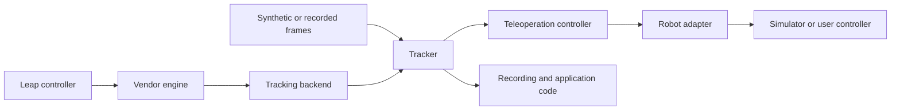

# Architecture

The package has three application layers: tracking supplies owned hand snapshots;
control maps a calibrated hand into bounded Cartesian targets; adapters translate
those targets to a controller's interface. The browser lab combines these layers
with a simulated controller.

## Module map

| Location | Responsibility |
| --- | --- |
| `tracker.py`, `_latest.py`, `health.py` | Source lifecycle, sequential/latest acquisition, freshness, and health counters |
| `backends/` | LeapC ctypes, legacy WebSocket, automatic selection, shared private engine, demo, and replay |
| `models.py`, `recording.py` | Immutable snapshots, SI units, versioned streaming recordings |
| `mapping.py`, `_geometry.py` | Coordinate transforms and quaternion operations |
| `control.py`, `control_config.py`, `control_models.py` | Pure control state machine, strict configuration, poses, commands, and feedback |
| `teleoperation.py`, `adapters/` | Synchronous control/adapter integration, callback adapter, and simulated arm |
| `runtime*.py`, `delivery.py`, `setup.py`, `_broker.py` | Discovery, pinned delivery/cache, explicit device setup, and shared runtime ownership |
| `cli.py`, `lab.py`, `lab.html`, `lab.js`, `lab.css` | Console entry point and packaged loopback browser lab |

## Data and lifetime

`Tracker` owns its source. Sequential mode preserves read order. Latest mode uses
one acquisition worker and one pending snapshot; a slow application reads the newest
unread frame rather than building an unbounded queue. Health counts skipped frames.

Frames contain no SDK pointers. Positions use metres, velocity uses metres/second,
and orientations use named quaternion components. Device timestamps retain their
clock domain. Empty-hand frames are valid. Local receipt age is not end-to-end camera
latency. See [data conventions](USAGE.md) and [latest mode](LATEST_FRAMES.md).

## Control and controller integration

`TeleoperationController` computes commands without opening devices or robot SDKs.
`Teleoperator` reads a tracker and invokes an adapter on the calling application thread.
An explicit arm operation anchors one selected hand to robot feedback or an explicit
reference. Clutch holds output and resume re-anchors. Tracking loss is latched;
returning hand frames alone do not rearm output.

Configuration controls workspace, axes/frame rotation, gains, smoothing/deadband,
linear/angular speed limits, output rate, and optional orientation/gripper mapping.
`CallbackAdapter` wraps an existing SDK; `SimulatedArm` supplies immediate Cartesian
feedback. The core does not supply inverse kinematics, collision checking, motor
drivers, or an SDK-specific network receiver. A controller integration provides those
where needed and enforces command expiry/hold at the receiving controller.

See [teleoperation](TELEOPERATION.md) for states, ownership, and adapter callbacks.

## Runtime ownership

Live tracking uses the proprietary vendor engine. The Python wheel contains no
vendor executable, DLL, or model. Windows can reuse a working service or obtain a
separately versioned, hash-pinned runtime. A shared coordinator owns the private
engine while clients hold leases and closes it after the final client leaves.

Importing the package performs no network calls, device access, or background startup.
Explicit setup handles driver approval. The normal launcher does not install or stop
system services. Linux/macOS currently use an installed native vendor service.
See [runtime setup](RUNTIME.md) and [platform status](INSTALLATION_PLATFORMS.md).

## Evidence and boundaries

[b3 validation](B3_VALIDATION.md) records the live Windows hand test, soak, and Python
matrix. Hosted CI verifies software behavior across operating systems. Clean-Windows
driver setup, Linux/macOS controller hardware, and actual robot integration remain
separate checks. Earlier proposals are retained in [history](history/README.md).
